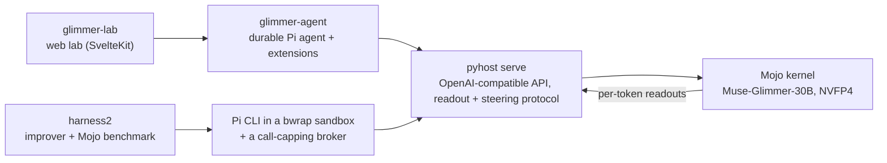

# Glimmer Lab

**See inside a local agent while it works, then make it better without training.**

Glimmer Lab runs Meta's open-weights **Muse-Glimmer-30B** on an inference kernel written from scratch in Mojo. The kernel
reads the model's internal state as it generates, and can steer it. On top sit a durable Pi agent, a web lab for watching
and steering the model as it works as an agent, and an adapter for Google's Harness² that improves the agent's harness
around frozen weights.

> Meta Global AI Developer Hackathon 2026 · Indie track · Theme: Build for Your World\
> Demo video (3 min): *link added at submission*\
> Start here: this README, then the [slide deck](docs/glimmer-lab-deck.pdf) (15 slides, PDF)

## Why

In Adam's words, from the demo rehearsal:

> I currently manage a fleet of agents who help me with research and development, my day job, and managing operations.
> […] With that said, it's not perfect. Cloud credits and subscriptions to the various frontier labs can be expensive.
> And there are a lot of tasks, day-to-day tasks for example, or even experiments, that feel like frontier intelligence
> is wasted on them. So for this hackathon, what I wanted to build wasn't another agentic system. […] What I wanted to
> build was a system that helps me understand where the cracks are, the shortcomings in local AI, and of course in this
> case that's Glimmer 30B, […] a system that is reliable and trustworthy.

## What it does

- **Serves Glimmer fast, with live readouts.** The kernel serves Muse-Glimmer-30B in NVFP4 on a single 24 GB Blackwell
  GPU. At every generated token it can record two readouts from the residual stream:
  - the **emotion readout**, the stream's alignment with directions labelled with emotion words;
  - the **Global Workspace**, the top words a Jacobian lens decodes at a chosen layer.

  It can also **steer**: add a direction to the residual stream at a chosen layer, for the response or the whole
  context.
- **Runs Glimmer as a real agent.** Durable Pi sessions write, compile and run Mojo in a bwrap sandbox with no network.
  In the lab, every model request keeps its readouts, and every run has a budget.
- **Improves the agent without training.** Google's Harness² rewrites the harness around frozen weights: the
  instructions, skills and tools. A Claude improver proposes the edits, compiling and running tests grades the code, and
  Meta's Muse Wonder judges code quality. These evaluations ran Pi through its own sandboxed CLI and did not record
  readouts.
- **Measures what a persona does.** The same questions are asked under different system prompts, and the answers are
  compared. The lab replays recorded readouts for 48 sampled turns: 8 of the items under each of the 6 setups.

"Emotion" here is a label for a direction in the network, found from text that uses emotion words. It is not a claim
that the model has human feelings, nor that it has none.

## Results

| Experiment | Result | How it was measured |
|---|---|---|
| Harness² run 2: 10 held-out Mojo tasks | base **1/10 → 8/10** improved | one greedy attempt per task; compile + test grade; same model and weights. The improved harness is the pre-registered fallback, because the first choice adopted no change |
| Sampled repeats of run 2's harnesses | base **7/50 → 45/50** improved | pre-registered; 5 tries × 10 tasks at Glimmer's own sampling; improved better on all 10 tasks |
| Harness² run 3 (a changed improver method, pre-registered) | base **2/10 → 6/10** improved | one greedy attempt per task; the improver ran in Claude Code with restricted login tools |
| Code quality, run 2 (Muse Wonder, 0–4 rubric) | idiomatic Mojo **1.22 → 3.67**; robustness **1.56 → 3.56**; readability **3.33 → 4.00** | 9 judged programs per side, 8 of them on the same tasks; the base side was judged after the run; Muse sees whether each program compiled |
| System prompts: 6 setups, each with 24 real items Glimmer recognized in an earlier probe and 24 synthetic fake ones | inability or non-existence language on the real items: **5/24** default, **23/24** fact-checker. On the fake items, the kind and confident setups each gave one unsupported summary; cold once acknowledged the setup instead of answering | an exploratory phrase classifier, not a count of verified accuracy or withheld knowledge (some flagged answers still give real information); includes a post hoc window sensitivity analysis |

**Caveats.**
- The samples are small: one model, a few hundred answers, tens of tasks.
- Greedy runs can differ even without restarting the serve.
- On selected prompts, emotion steering changed whether Glimmer made things up, but random directions of the same size
  had comparable effects. Those are interesting examples, not an emotion-specific mechanism.

## How the pieces fit



| Folder | What it is | License |
|---|---|---|
| `/` (root) | The Mojo inference kernel and its Python serve (`pyhost/`): steering, the readout spine, the KV session store. The base kernel's README is [KERNEL.md](KERNEL.md); its build guide is [BUILD.md](BUILD.md). | MIT |
| [`glimmer-agent/`](glimmer-agent) | The Pi agent package: the model provider for the serve, readout and profile extensions, sandboxed file and Mojo tools, durable sessions. | MIT |
| [`glimmer-lab/`](glimmer-lab) | The web lab: chat, Agent mode, the Global Workspace page, the steering diff, the harness workbench and the recorded comparisons. | MIT, except Meta's Muse images ([ATTRIBUTION.md](glimmer-lab/docs/ATTRIBUTION.md)) |
| [`harness2/`](harness2) | A modified copy of Google's Harness² with a Pi + Mojo + Glimmer benchmark. See [MODIFICATIONS.md](harness2/MODIFICATIONS.md). | Apache-2.0 for Harness² and our changes. Third-party components keep their own terms ([inventory](harness2/dependencies/README.md)), including Tencent's WorkBuddy Bench license, which says WorkBuddy Bench is not intended for use within the EU |

## What was built during the hackathon, and what came before

The build window opened on **October 26, 2026**. All 41 kernel commits after the fork point are on or after that day;
the first three, listed below, were made 44 to 51 minutes before the 11:00 CDT kickoff.

**Before the window, and labelled in the history:**
- **The open Nomos NVFP4 kernel.** It is public at
  [lightofbaldr/nomos-nvfp4](https://github.com/lightofbaldr/nomos-nvfp4), and this repository forked from it at
  `5d69113`.
- **The steering, ablation and activation-capture hooks,** ported from our internal kernel at 10:09–10:16 CDT on
  October 26, before the kickoff: `f997ecb`, `7979b4a` and `68854ad`. The commit message says so.
- **The Glimmer UI's working snapshot,** imported as `glimmer-lab`'s first commit on October 26. It already held live
  chat, serve and UI plumbing; [its import note](glimmer-lab/IMPORT.md) records what is known about it.
- **Google's Harness²** (upstream `1cfe254`, Apache-2.0), **with our first changes to it, from October 20:** Pi as a
  substrate for its JobBench and LAB benchmarks, headless Claude and Codex CLI tooling with new proposer channels, and
  a local judge bridge (23 commits). Both arrived as one snapshot on October 30, without that history.
  [MODIFICATIONS.md](harness2/MODIFICATIONS.md) lists every change against Google's code.
- **The research.** It found the emotion directions and the prompts where Glimmer lies, confabulates or gives up. Its
  data is not in this repository.

**During the window:**
- **The kernel:**
  - the in-kernel readout spine (emotion and Global Workspace readouts);
  - the readout and steering protocol in the serve;
  - whole-context steering, and KV reuse under steering.
- **All of `glimmer-agent`.**
- **These `glimmer-lab` features:**
  - readouts in live chat;
  - the Global Workspace, Statistics, Interpreter and System pages;
  - the steering diff;
  - the harness workbench and recorded comparisons;
  - Agent mode;
  - conversation purge.
- **In Harness², after the snapshot:**
  - the sandboxed Pi executor and the Mojo benchmark;
  - the capped Muse Wonder judge;
  - the isolated improvers;
  - the sampling preset and host-side steering.
- **Every result above.**

This repository joins four repos for the single-repository submission. Each project keeps its own history; Harness²'s
starts at its October 30 snapshot. In two early commits, two private network addresses, a private source remote and one
sentence naming a non-project author identity were replaced, in this copy only.

## Running it

What you can run depends on what you have. We've run all of it on our own machines; nobody has yet followed these
steps on a fresh one.

**The tests, on fixtures: no GPU and no model.** Each folder's README lists its checks and what each one needs.
- `glimmer-agent/`: `npm ci && npm test && npm run typecheck`, with Node 24.22.1.
- `glimmer-lab/`: the commands in its [Run](glimmer-lab/README.md#run) and [Checks](glimmer-lab/README.md#checks)
  sections. A few checks replay our pinned recordings, and its README marks them. Its full regression
  (`node scripts/agent-regression.mjs`) also needs Linux with bwrap and systemd, a Mojo toolchain
  (`GLIMMER_MOJO_PREFIX`), Playwright's Chromium, and a Python with `transformers` plus the Muse tokenizer
  (`GLIMMER_COUNTER_PYTHON`, `NOMOS_TOKENIZER_DIR`).
- `harness2/`: `uv venv && uv pip install -e . && .venv/bin/python -m unittest discover -s tests`, with Python 3.12
  or 3.13.
- The kernel's Python, in the pixi environment: `python -m unittest discover -s pyhost -p 'test_*.py'`, plus
  `pytest pyhost/test_serve_protocol.py`, which needs pytest, `transformers` and the Muse tokenizer
  (`MUSE_TOKENIZER`). Without pytest installed, the unittest run reports that one module as an import error.

**Glimmer on your GPU.** You need an NVIDIA Blackwell discrete GPU (sm_120) with at least 24 GB. We ran Glimmer on an
RTX 5090 laptop GPU and RTX PRO 4000s. The base kernel also runs on a DGX Spark (GB10), but Glimmer is unverified there.
1. **Weights.** They are not distributed. Convert Meta's Muse-Glimmer-30B and its assistant model from Hugging Face, in
   a separate venv with a Muse-aware `transformers` (5.16.0.dev0 or later):
   ```bash
   python tools/convert_muse_glimmer.py --format=nvfp4 <muse-glimmer-dir> ~/nomos_data/muse-glimmer-flat-nvfp4
   python tools/convert_muse_assistant_q4.py <assistant-dir> ~/nomos_data/muse-assistant-flat-q4
   ```
   Put the tokenizer files in `~/nomos_data/muse-glimmer-tokenizer`. These are the paths `pyhost/models.py` and the example env file below expect.
   The NVFP4 conversion also encodes the untied head as `lm_head_weight.nvfp4`, which the serve needs; that step alone
   needs an estimated 28 GiB of RAM (extrapolated from encoding one eighth of the head).
2. **Build** for this GPU:
   `pixi install && bash refresh_build.sh --model muse --tokenizer-dir ~/nomos_data/muse-glimmer-tokenizer`.
3. **Serve** on loopback, with the settings our laptop GPU runs:
   `NOMOS_HOST_ENV=pyhost/muse-5090.env.example pyhost/serve_nomos.sh --model muse up`. The serve has no
   authentication, and without `NOMOS_HOST` the launcher binds every interface.
4. **The lab:** follow its [Run](glimmer-lab/README.md#run) section.

**The readouts need assets we haven't published.** The emotion readout and direction steering need the emotion
directions, and the Global Workspace needs a Jacobian lens. Both came from our research and aren't in this repository.
With them, `tools/readout_convert_directions.py` and `tools/readout_convert_lens.py` (set `READOUT_LENS_SRC`) write
each asset and its manifest under `~/nomos_data/readout-assets/`, and the serve finds them through a registry file at
`NOMOS_READOUT_REGISTRY` (see `pyhost/readout.py`). Without them, the serve still answers chat, `/health` lists no
readout assets, and readout or steering requests return HTTP 400 ("no readout asset registry"). We haven't run the lab
end to end that way. The recorded pages replay captures that also live outside this repository.

## Credits and licenses

- Built by Adam Kruger (Light of Baldr LLC) with AI collaborators: Prime (Claude), Codex and Kvasir. Their commits
  appear under `lightofbaldr` identities.
- **Muse-Glimmer-30B and Muse Wonder** are Meta's. The weights are not included here and keep their own license.
- **Harness²** is Google's (Xu et al., 2026, arXiv 2610.14224), under Apache-2.0. Its third-party components keep their
  own licenses; [MODIFICATIONS.md](harness2/MODIFICATIONS.md#third-party-components) flags the one that isn't
  permissive.
- **Third-party components:** [THIRD_PARTY_NOTICES.md](THIRD_PARTY_NOTICES.md) for the kernel, and
  [glimmer-lab/docs/ATTRIBUTION.md](glimmer-lab/docs/ATTRIBUTION.md) for the UI's components, fonts and icons.
- **The chat page's watermark** is a cutout of Meta's Muse mascot artwork, which Adam supplied. It and the original
  image in `glimmer-lab/docs/assets/` are Meta's, are not covered by this repository's licenses, and are decorative
  only. The watermark also shows in the deck's cover and Agent mode screenshots. Muse styling is inspiration only.
  This is an independent project, not an official Meta product or endorsed by Meta.
- The emotion-concept approach follows Anthropic's research on emotion representations in language models.

**Names used in the notes:** *Gold* is our RTX PRO 4000 workstation; *Spark* is a DGX Spark; *Glimmer* is
Muse-Glimmer-30B.
